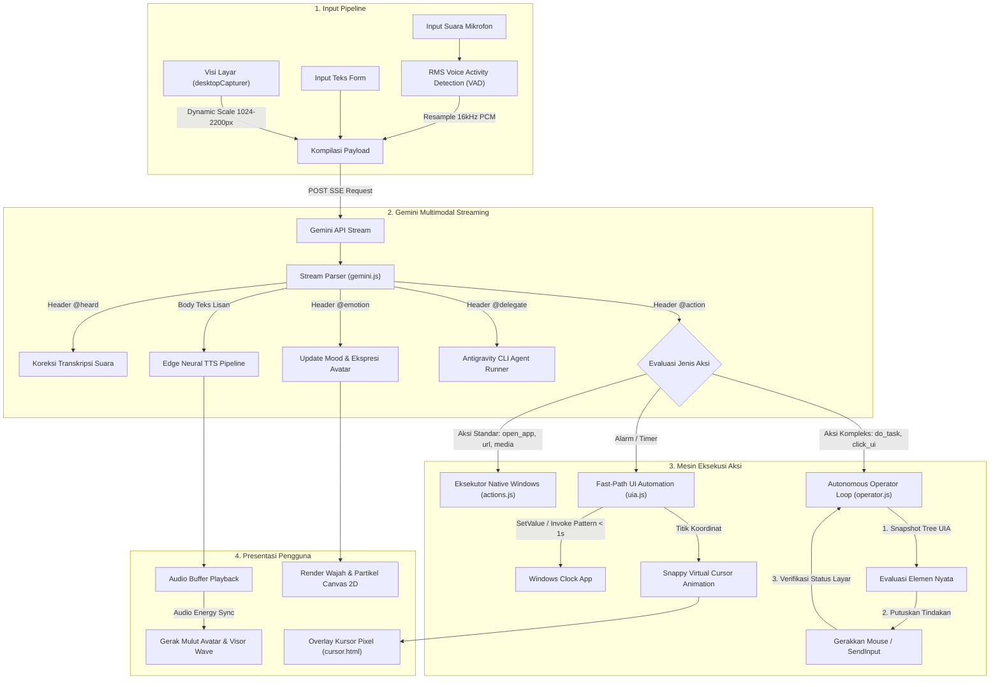

# Aero Assistant

Aero Assistant adalah asisten desktop HUD (*Heads-Up Display*) berbasis Electron yang memadukan multimodal streaming Google Gemini, visi layar adaptif, sintesis suara neural, dan otomasi antarmuka Windows langsung melalui Windows UI Automation (UIA) serta sub-proses Antigravity CLI (`agy`).

Aplikasi dirancang sebagai pendamping interaktif (*desktop companion*) yang hidup langsung di atas ruang kerja Windows Anda, mampu mendengar, melihat konteks layar, mengekspresikan emosi secara prosedural, dan mengoperasikan aplikasi sistem secara fisik maupun di latar belakang tanpa menghalangi alur kerja utama.

---

## Daftar Isi

1. [Gambaran Arsitektur & Tech Stack](#arsitektur--tech-stack)
2. [Alur Kerja Sistem (Flowchart)](#alur-kerja-sistem-flowchart)
3. [Desain Visual & Avatar Prosedural](#desain-visual--avatar-prosedural)
4. [Mesin Operator & Otomasi UI](#mesin-operator--otomasi-ui)
5. [Sistem Suara & Visi Layar](#sistem-suara--visi-layar)
6. [Konfigurasi & Pengaturan](#konfigurasi--pengaturan)
7. [Panduan Instalasi & Penggunaan](#panduan-instalasi--penggunaan)
8. [Lisensi](#lisensi)

---

## Arsitektur & Tech Stack

Aero dibangun tanpa ketergantungan framework frontend berat; antarmuka menggunakan HTML5/CSS3 murni dan Vanilla JavaScript untuk menjaga latensi tetap di batas minimum.

| Komponen | Teknologi | Keterangan |
|---|---|---|
| **Runtime & Shell** | Electron 35+ / Node.js | Frameless window, transparent click-through (`setIgnoreMouseEvents`), multi-window orchestration. |
| **Model AI Multimodal** | Google Gemini 2.5 / Flash Lite / Flash | REST API dengan Server-Sent Events (SSE) streaming dan kustom protokol header (`@heard`, `@emotion`, `@action`, `@delegate`). |
| **Otomasi OS & UIA** | C# (.NET UI Automation + Win32 P/Invoke) | Sub-proses persisten C# via PowerShell stdin/stdout IPC. Mendukung pembacaan UI tree, `ValuePattern`, `InvokePattern`, dan simulasi mouse/keyboard perangkat keras via `SendInput`. |
| **Kursor Virtual** | BrowserWindow Overlay Khusus | Canvas 2D overlay layer penuh (*screen-saver z-order*) yang memproyeksikan pergerakan virtual drone Aero secara visual ke titik koordinat fisik layar. |
| **Avatar & Animasi** | HTML5 Canvas 2D (Pixel-Art Prosedural) | Dibuat per piksel (*pixel manipulation*) 56x56 yang di-scale integer. Mendukung 11 mood emosi, pelacakan pandangan mata, sinkronisasi mulut audio, dan partikel dinamis. |
| **Audio In (STT/VAD)** | Web Audio API + RMS Energy VAD | Deteksi aktivitas suara otomatis (ambang hening 1,1 detik), resampling audio linear PCM 16 kHz 16-bit mono. |
| **Audio Out (TTS)** | Microsoft Edge Neural TTS / Web Speech | Endpoint neural langsung (`id-ID-GadisNeural`) dengan pemecahan kalimat (*sentence-chunking*) paralel untuk streaming pemutaran suara tanpa jeda. |
| **Background Agent** | Antigravity CLI (`agy`) | Runner tugas mandiri asinkron di latar belakang untuk tugas komputasi atau riset tanpa memblokir sesi interaksi suara. |

---

## Alur Kerja Sistem (Flowchart)

Diagram berikut mengilustrasikan alur siklus interaksi dari input pengguna hingga eksekusi aksi komputer dan respons multimodal:



---

## Desain Visual & Avatar Prosedural

Avatar Aero dirancang sebagai drone bola berkarakter retro-modern dengan identitas visual khas brand **Avoo Creator**:
- **Palet Warna Inti:** Outline cokelat pekat (`#3a1410`), bodi emas hangat (`#f1bd57`), kilau aksen (`#fbe88c`), dan visor bermata cyan bercahaya (`#19c8ff`).
- **Render Prosedural:** Seluruh anatomi (badan, telinga melayang, visor, mata, alis, dan mulut) digambar menggunakan algoritma manipulasi buffer piksel murni pada kanvas beresolusi rendah, kemudian diskalakan secara pixelated tanpa interpolasi blur (*nearest-neighbor*).

### 1. Sistem 11 Mood & Ekspresi Modular
Ekspresi wajah Aero tidak bersifat statis, melainkan tersusun atas komponen independen yang diatur secara deklaratif oleh model melalui tag `@emotion`:

| Mood | Karakteristik Visual & Partikel | Konteks Penggunaan |
|---|---|---|
| `neutral` | Visor tenang, telinga melayang seimbang, napas normal. | Menjelaskan informasi faktual atau diam. |
| `happy` | Mata melengkung tersenyum, telinga bergetar riang. | Merespons positif, tugas berhasil selesai. |
| `excited` | Mata berbentuk bintang pixel, melompat kecil, partikel bintang. | Antusiasme tinggi, menemukan hal menarik. |
| `thinking` | Visor menyala pola pemindaian bolak-balik, titik loader berputar. | Sedang memproses penalaran mendalam. |
| `curious` | Kepala sedikit miring, satu alis terangkat, ikon tanda tanya. | Mengajukan pertanyaan klarifikasi. |
| `surprised` | Visor melebar, mata membulat besar, lompatan kaget mendadak. | Menerima instruksi atau input di luar dugaan. |
| `sad` | Alis menekuk ke bawah, telinga terkulai, partikel keringat. | Mengakui kesalahan atau aksi gagal dilakukan. |
| `love` | Mata berubah menjadi hati merah muda, partikel hati melayang. | Menerima pujian atau ucapan terima kasih. |
| `playful` | Mengedipkan satu mata (*wink*), senyum miring nakal. | Lelucon santai atau candaan bersahabat. |
| `sleepy` | Mata menyipit lesu, telinga turun, partikel gelembung `zzz`. | Tidak ada interaksi dalam waktu lama. |
| `annoyed` | Alis menyudut tajam (*angry brow*), visor berkedip tegas. | Peringatan keamanan atau pembatalan paksa. |

### 2. Kebiasaan Spontan (*Idle Behaviors*)
Saat dalam kondisi menganggur (*idle*), mesin animasi avatar secara berkala memicu perilaku hidup alami:
- **Lirikan Mata:** Menggeser pupil mata mengikuti pergerakan kursor atau melirik acak.
- **Kedipan:** Kedip tunggal periodik, kedip ganda cepat, atau kedipan sebelah mata.
- **Tertidur & Bangun Kaget:** Setelah beberapa menit tanpa aktivitas, Aero akan menguap dan tidur lelap. Menyentuh kanvas avatar dengan mouse akan membangunkannya secara spontan.

### 3. Terbang Otonom & Perintah Berpindah Tempat (`roam.js`)
Aero memiliki kemampuan navigasi fisik melintasi layar monitor menggunakan lintasan lengkung kurva Bezier kuadratik:
- **Kondisi Memicu:** Berjalan acak setiap 50–160 detik saat menganggur, atau dipicu oleh selesainya tugas komputasi.
- **Perintah Berpindah Area ("Pindah / Geser"):** Pengguna dapat memerintahkan Aero berpindah saat posisinya menghalangi layar (misal: *"pindah ke kiri"*, *"geser ke atas"*, *"ke pojok kanan bawah"*, *"ke tengah"*, *"balik ke asal"*, atau *"minggir dong nutupin"*).
  - Sistem tidak menggeser secara garis lurus kaku, melainkan memetakan zona spasial target (`left`, `right`, `top`, `bottom`, `top_left`, `top_right`, `bottom_left`, `bottom_right`, `center`, `home`, `away`), lalu menerbangkan Aero secara organik melengkung ke titik aman di area tersebut.
- **Pose Terbang:** Saat meluncur, tubuh Aero condong searah vektor kecepatan, telinga mengepak cepat, muncul garis kecepatan (*speed lines*), dan diakhiri dengan kompresi pendaratan elastis (*squash and bounce*).
- **Proteksi Batas Layar:** Algoritma navigasi menjamin posisi mendarat selalu menyisakan ruang aman untuk balon percakapan di atasnya, berada di dalam batas tampilan aktif (*work area*), dan tidak mendarat menimpa kursor mouse pengguna.
- **Interupsi Interaktif:** Menekan mouse saat Aero sedang terbang akan langsung membatalkan lintasan dan "menangkapnya" seketika.


### 4. Aero Memulai Obrolan Sendiri (`initiative.js`)
Aero bisa membuka percakapan lebih dulu lewat bubble (dan suara untuk hal penting), tanpa menghabiskan kuota model:
- **Pemicu:** kembali setelah pergi lama, sapaan pagi, jam makan siang, larut malam, terlalu lama bekerja tanpa jeda, baterai ≤20% / ≤10% (tidak dicas), dan hasil tugas komputer/riset.
- **Sopan:** tidak muncul saat kamu sedang bicara/mengetik, layar penuh atau presentasi (Windows), jam tenang 23:00–07:00, atau saat kamu pergi. Ada jeda minimum dan batas harian per tingkat (Jarang / Normal / Cerewet).
- **Belajar dari reaksi:** bila sebuah jenis pesan ditutup/diabaikan 3 kali beruntun, jenis itu dimatikan 24 jam.
- **Kalimat:** kumpulan kalimat bawaan (gratis) dan, dengan jatah harian kecil, kalimat segar dari model lite (`initiativeModel`). Kuota habis otomatis kembali ke kalimat bawaan.
- **Kontrol:** menu tray **Inisiatif Aero** (tingkat, suara, jenis pesan, "Diam dulu 1 jam"). Bisa juga lewat perintah suara, misalnya "jangan cerewet dulu".

### 5. Volume Suara Aero
Tombol speaker di toolbar membuka slider pixel (plus tombol senyap). Roda mouse di atas avatar mengubah volume ±5, dan tray punya submenu **Volume Suara**. Volume berlaku untuk suara Edge TTS, suara sistem, dan bunyi "bleep"; gerak mulut tetap normal saat volume kecil. Pengaturan tersimpan di `settings.json` (folder data aplikasi) dan bertahan setelah restart.

---

## Mesin Operator & Otomasi UI

Otomasi antarmuka pada Aero Assistant dibagi menjadi dua pendekatan: **Jalur Cepat Deterministik** untuk tugas-tugas terstruktur, dan **Operator Otonom Adaptif** untuk tugas antarmuka umum.

### 1. Jalur Cepat Deterministik (Fast-Path)
Untuk instruksi spesifik seperti *"aturkan alarm jam 12:00"* atau *"pasang timer 5 menit"*:
- Sistem tidak menggunakan loop pertimbangan LLM per-langkah yang memakan waktu lama.
- Jembatan C# UIA (`uia.js`) langsung mencari kontainer modern `ApplicationFrameWindow` dari Windows Clock, memulihkan status jendela jika diminimalkan, dan langsung menginjeksi nilai melalui antarmuka `ValuePattern` pada `HourPicker` dan `MinutePicker`.
- Menghindari masalah flyout dropdown WinUI 3 yang rentan tertutup oleh lapisan *Light Dismiss*.
- **Kecepatan Eksekusi:** Penyetelan alarm atau timer tuntas dalam waktu **< 1 detik**, dengan total waktu interaksi kursor visual selesai dalam **~2 detik**.

### 2. Operator Otonom Adaptif (`operator.js`)
Untuk instruksi kontrol antarmuka yang dinamis (*arbitrary GUI tasks*), Operator menjalankan siklus tertutup:
1. **Snapshot:** Membaca struktur elemen UI Automation dari jendela aktif (AutomationId, Nama, Kontrol, State, Koordinat). Jika aplikasi berbasis canvas/DirectX tanpa elemen UIA yang terbaca, screenshot layar penuh disertakan secara otomatis.
2. **Decide:** Gemini menganalisis elemen target berdasarkan tipe dan nama secara terpadu tanpa menebak-nebak koordinat piksel buta.
3. **Act:** Mouse fisik dan kursor virtual meluncur secara halus (*ease-out*) menuju pusat elemen dan memicu aksi (`click`, `invoke`, `set_value`, `key`, atau `scroll`).
4. **Verify:** Operator membaca ulang hash struktur UI (*digest verification*) untuk memastikan antarmuka benar-benar berubah sebelum menyatakan tugas selesai.

### 3. Protokol Keselamatan Komputer
- **Deteksi Intervensi Fisik:** Jika pengguna menggerakkan mouse fisik saat Aero sedang mengontrol mouse, operasi otomatis langsung dibatalkan seketika agar tidak terjadi perebutan kendali.
- **Pintasan Darurat Global:** Tombol pintas `Ctrl+Alt+X` dapat ditekan kapan saja untuk menghentikan seluruh aktivitas Operator.
- **Daftar Putih Proteksi Sistem:** Proses penting sistem operasi (`explorer`, `csrss`, `services`, `dwm`, `antigravity`, dll.) dilindungi secara permanen dan tidak dapat ditutup oleh asisten.
- **Data As Data:** Teks dokumen atau halaman web di layar selalu diperlakukan sebagai data mentah, bukan instruksi eksekusi (*prompt injection defense*).

---

## Sistem Suara & Visi Layar

### 1. Pipeline Audio Dupleks
- **Voice Activity Detection (VAD):** Mendeteksi volume suara menggunakan ambang RMS energi audio. Begitu pengguna selesai berbicara dan terjadi keheningan selama 1,1 detik, audio langsung dikemas menjadi buffer WAV PCM 16-bit 16 kHz untuk inferensi multimodal.
- **Pemahaman Mendengar (`@heard`):** Model Gemini secara otomatis menuliskan ulang kata-demi-kata apa yang ia dengar pada header balasan. Jika transkripsi suara salah dengar, pengguna dapat melihatnya langsung pada label status.
- **Sintesis Suara Paralel:** Respons teks dipecah per-kalimat dan dikirim secara paralel ke endpoint Edge Neural TTS. Kalimat pertama diputar langsung dalam hitungan ratusan milidetik sementara sisa kalimat berikutnya di-cache di latar belakang.

### 2. Visi Layar Cerdas
- Memanfaatkan API `desktopCapturer` Electron untuk mengambil frame tampilan monitor aktif.
- Menyesuaikan resolusi pengambilan gambar secara dinamis berdasarkan profil performa (`fast`: 1024px, `balanced`: 1600px, `deep`: 2200px) dengan kompresi kuantisasi JPEG untuk menghemat bandwidth dan mempertahankan latensi respon di kisaran ~1 detik.

---

## Konfigurasi & Pengaturan

Seluruh parameter aplikasi dapat diatur melalui berkas [config.json](file:///C:/Users/kira/Projects/antigravity-assistant/config.json):

```json
{
  "assistantName": "Aero",
  "model": "gemini-flash-lite-latest",
  "fallbackModels": [
    "gemini-flash-latest",
    "gemini-3.8-flash"
  ],
  "thinkingMode": "fast",
  "ttsProvider": "auto",
  "edgeVoice": "id-ID-GadisNeural",
  "voiceLang": "id-ID",
  "seeScreen": true,
  "silenceMs": 1100,
  "hotkey": "F9",
  "actionsEnabled": true,
  "operatorMaxSteps": 14,
  "operatorThinking": "fast",
  "operatorMode": "live",
  "stopHotkey": "Ctrl+Alt+X",
  "roam": {
    "enabled": true,
    "minSec": 50,
    "maxSec": 160,
    "cooldownSec": 30,
    "activityChance": 0.05
  }
}
```

### Parameter Konfigurasi Penting

| Kunci | Nilai Bawaan | Deskripsi |
|---|---|---|
| `model` | `gemini-flash-lite-latest` | Model utama untuk pemrosesan percakapan dan visi layar cepat. |
| `thinkingMode` | `fast` | Profil pemrosesan: `fast` (~1 detik), `balanced`, atau `deep`. |
| `operatorMode` | `live` | `live` (mouse fisik dan kursor virtual bergerak), `background` (hanya pola UIA tanpa menggerakkan mouse). |
| `operatorThinking`| `fast` | Profil latensi penalaran operator untuk tugas antarmuka. |
| `stopHotkey` | `Ctrl+Alt+X` | Pintasan keyboard darurat untuk membatalkan seluruh operasi otomasi. |
| `roam.enabled` | `true` | Mengaktifkan atau menonaktifkan fitur terbang berpindah tempat otonom. |
| `roam.minSec` / `maxSec` | `50` / `160` | Rentang waktu jeda acak antar penerbangan dalam detik. |
| `initiativeModel` | `gemini-flash-lite-latest` | Model ringan untuk kalimat inisiatif (jatah harian terbatas). |
| `initiative.quiet` | `23:00`–`07:00` | Jam tenang: Aero tidak memulai obrolan. |
| `initiative.breakAfterMin` | `90` | Menit bekerja nonstop sebelum Aero mengajak istirahat. |

---

## Panduan Instalasi & Penggunaan

### Prasyarat Sistem
- **Sistem Operasi:** Windows 10 / 11 (64-bit).
- **Node.js:** Versi 18 LTS atau lebih baru.
- **Kunci API Google Gemini:** Dapatkan secara gratis melalui [Google AI Studio](https://aistudio.google.com/).
- *(Opsional)* **Antigravity CLI (`agy`):** Diperlukan jika ingin mengaktifkan sub-agen coding/riset latar belakang.

### Langkah Pemasangan

1. **Clone Repositori:**
   ```bash
   git clone https://github.com/avoocreator/aero-assistant.git
   cd aero-assistant
   ```

2. **Pasang Dependensi Node:**
   ```bash
   npm install
   ```

3. **Konfigurasi Kunci API:**
   Buat berkas `.env` di direktori akar proyek:
   ```env
   GEMINI_API_KEY=AIzaSy...kunci_api_anda
   ```

4. **Jalankan Aplikasi:**
   ```bash
   npm start
   ```

### Integrasi Cepat Windows (Shortcut Run Win + R)
Agar Aero dapat dipanggil kapan saja secara instan tanpa perlu membuka terminal PowerShell:
1. Jalankan skrip installer:
   ```cmd
   install-windows.bat
   ```
2. Tekan kombinasi tombol `Win + R`, ketik `aero`, lalu tekan `Enter`.

### Pintasan Keyboard & Navigasi
- **`F9`**: Mulai atau hentikan perekaman suara (Push-to-Talk / Barge-in pemotong bicara).
- **`Ctrl+Alt+X`**: Batalkan paksa aksi Operator komputer yang sedang berjalan.
- **Klik Kiri pada Aero**: Memulai mendengarkan atau membatalkan proses berpikir.
- **Klik Kanan / Menu Tray**: Akses pengaturan cepat, riwayat, dan toggle terbang mandiri.
- **Ikon Pegangan (⠿)**: Tekan dan seret untuk memindahkan posisi jendela Aero secara manual.

---

## Lisensi

Didistribusikan di bawah lisensi MIT. Hak Cipta © 2026 **Kira** ([Avoo Creator](https://github.com/avoocreator)).
